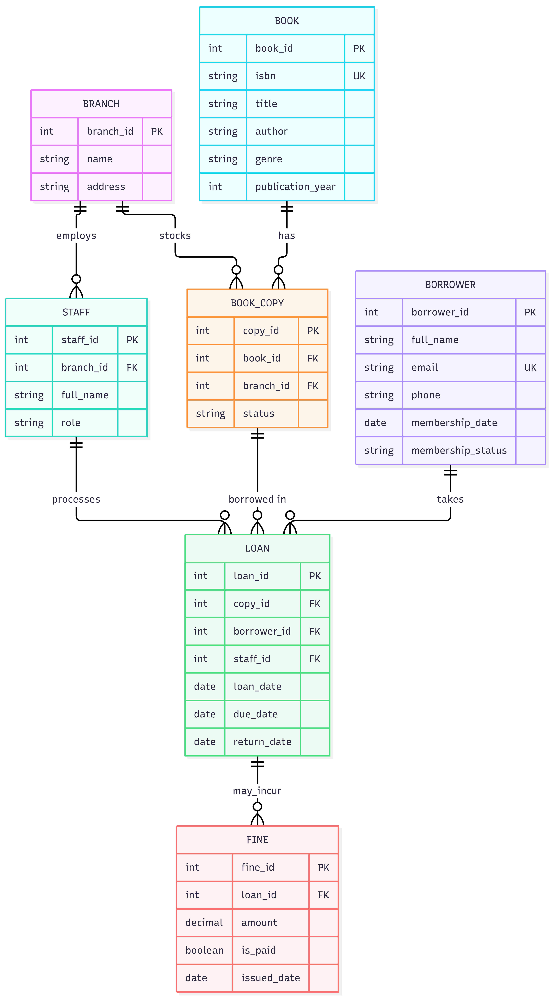
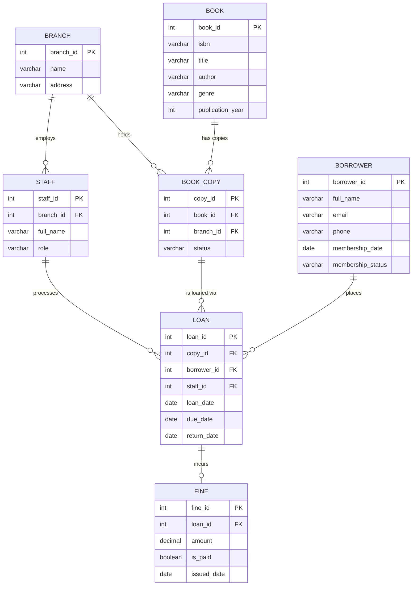

# Portfolio 1: Database Design and Modelling

## Case Study Statement

**Organisation:** Fortress Community Library (simulated public library system)

**Nature of the business:** Fortress Community Library is a mid-sized public library
with multiple branches. It lends physical books to registered members, tracks due
dates and fines, and employs staff who manage the catalogue and front-desk operations.

**Users of the database:**

- Librarians / staff (manage catalogue, process loans/returns, waive fines)
- Borrowers / members (search catalogue, borrow and return books)
- Library administrators (run reports, manage staff records)

**Major data to be stored:**

- Books (title, author, ISBN, genre, copies available)
- Borrowers (name, contact info, membership status)
- Staff (name, role, branch)
- Loans (which borrower borrowed which book copy, loan date, due date, return date)
- Fines (linked to overdue loans, amount, paid status)

**Key operations the database will support:**

- Register a new borrower
- Borrow a book (create a loan, decrement available copies)
- Return a book (close a loan, calculate fine if overdue)
- Calculate and pay fines
- Search the catalogue by title/author/genre
- Report overdue loans and most-borrowed books

This case study is used consistently across Portfolios 1–5.

---

## Entity-Relationship Diagram

---

## Why this design (modelling decisions)

- **BOOK vs BOOK_COPY separation**: A library owns several physical copies of the
  same title. Separating `BOOK` (catalogue metadata) from `BOOK_COPY` (a specific,
  loanable physical item) avoids duplicating title/author/ISBN data for every copy
  and lets us track each copy's status (available, loaned, lost, in repair)
  independently.
- **FINE as its own table rather than columns on LOAN**: Not every loan produces a
  fine. Modelling it separately avoids a table full of NULLs and makes fine
  payment/reporting easier to query and extend later (e.g., partial payments).
- **STAFF linked to LOAN**: Lets the library audit which staff member processed
  each transaction.

## Normalisation

**Unnormalised starting point (hypothetical flat spreadsheet):** a single sheet with
columns like `borrower_name, borrower_email, book_title, book_author, isbn,
loan_date, due_date, staff_name, branch_name...` in one row per loan.

- **1NF (atomic values, no repeating groups):** Each column holds a single atomic
  value (no "list of borrowed books" crammed into one cell), and each row
  represents one loan event. Achieved by giving `LOAN` its own row per
  book-copy/borrower pairing instead of listing multiple books per borrower row.
- **2NF (no partial dependency on part of a composite key):** Book details
  (title, author, genre) depend only on `book_id`, not on the loan — so they're
  moved into their own `BOOK` table rather than repeated on every `LOAN` row.
  Similarly borrower contact details depend only on `borrower_id`, so they live in
  `BORROWER`.
- **3NF (no transitive dependencies):** `branch_name`/`branch_address` depended on
  `staff_id` transitively (staff → branch → branch details) rather than directly on
  the loan, so `BRANCH` was separated out and `STAFF` references it by
  `branch_id` FK instead of repeating branch details per staff member.

The result is the normalised schema in `schema.sql`, which removes update/insert/
delete anomalies — e.g., changing a branch's address now requires updating one row
in `BRANCH`, not every staff/loan row associated with that branch.

## Keys & Constraints

- Primary keys: surrogate integer PKs on every table (`*_id`) for stability and
  indexing performance.
- Foreign keys: enforce referential integrity (e.g., a `LOAN` cannot reference a
  non-existent `BOOK_COPY`).
- `BOOK.isbn` has a `UNIQUE` constraint — no two catalogue entries share an ISBN.
- `BOOK_COPY.status` and `BORROWER.membership_status` use `CHECK` constraints to
  restrict them to valid enumerated values.
- `LOAN.due_date` enforced to be after `loan_date` via `CHECK`.

See `schema.sql` in this folder for the full implementation.

## Evidence of live implementation

Schema and data were loaded and verified against a real MariaDB 10.4.28
instance (XAMPP) via phpMyAdmin.

### `loan` table structure (live)

All 7 designed columns are confirmed present with correct types: the
primary key (`loan_id`, AUTO_INCREMENT), three foreign keys (`copy_id`,
`borrower_id`, `staff_id`, each marked with a key icon), a live
`curdate()` default on `loan_date`, and `return_date` correctly set as
the table's only nullable column — matching the design, since a loan is
only marked returned once.

### `loan` table indexes (live)

Confirms all 5 designed indexes exist on the live server: the `PRIMARY`
key plus `idx_loan_borrower`, `idx_loan_copy`, and `idx_loan_due_date`
(the same index investigated in Portfolio 2's optimizer behaviour
analysis — this is direct evidence it genuinely existed on the table at
the time of that testing). The cardinality of 8,132 on the primary key
confirms this is the table after Portfolio 2's bulk data load, not a
fresh, empty schema.
