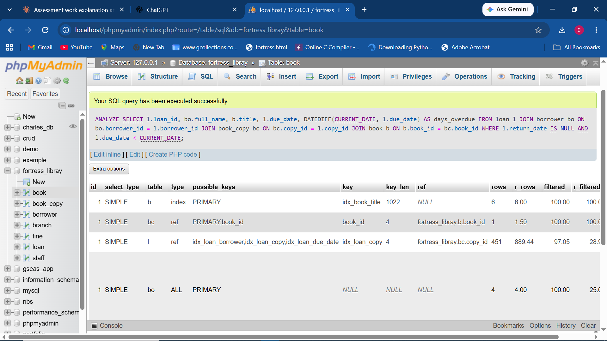
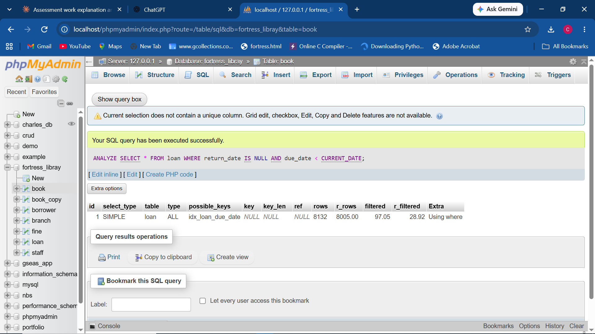
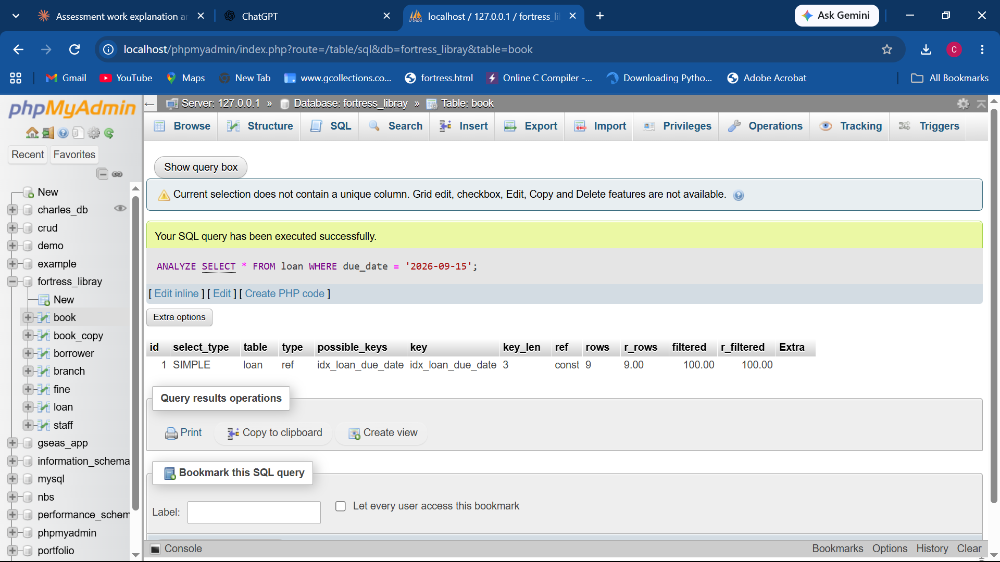

# Portfolio 2: Query Processing and Optimisation

## What to actually do (this is how to run it)

### Step-by-step

1. A live MySQL-compatible server. **XAMPP bundles MariaDB, not MySQL**
   (confirm with `SELECT VERSION();` — if it says `...-MariaDB`, you're on
   MariaDB and should follow the `ANALYZE SELECT` syntax below, not
   `EXPLAIN ANALYZE`). A real standalone MySQL 8.0+ install, Docker
   (`docker run --name fortress-mysql -e MYSQL_ROOT_PASSWORD=yourpassword
-p 3306:3306 -d mysql:8.0`), or a free hosted instance (Railway, Clever
   Cloud, FreeSQLDatabase) all work too if you'd rather use genuine MySQL.
2. Run `../portfolio-1-database-design/schema.sql`, then `sample_data.sql`.
3. To make the optimisation story meaningful, **bulk-insert extra rows** —
   a 9-row `loan` table won't show any real performance difference. Use
   `generate_bulk_data.sql` in this folder (or a Python/Faker script) to
   add thousands of loan rows first.
4. Run each query in `queries.sql`.
5. For **Q2, Q3, and Q4** (the ones touching `loan` most heavily), get the
   execution plan with actual run statistics:
   - **On MariaDB** (XAMPP default): `ANALYZE SELECT <query>;` — no
     `EXPLAIN` keyword. Look at the `r_rows` column (actual rows examined)
     and `type` column.
   - **On real MySQL 8.0.18+**: `EXPLAIN ANALYZE <query>;` — gives actual
     timing per step, in a text/tree format rather than a table.
   - **On MySQL below 8.0.18**: plain `EXPLAIN <query>;` plus the "Query
     took X seconds" line phpMyAdmin shows after running the query normally.
     Screenshot/paste the output into `execution_plans_before.txt`.
6. Note the access `type` column — look for `ALL` (full table scan, slow
   on large tables) vs `ref`, `range`, or `index` (an index is being used,
   fast). On MariaDB, also compare `rows` (the optimizer's _estimate_)
   against `r_rows` (what _actually_ happened) — a big gap between them is
   itself worth discussing in your write-up.
7. Confirm the indexes from `schema.sql` exist (`idx_loan_borrower`,
   `idx_loan_due_date`, etc. — check with `SHOW INDEX FROM loan;`). If a
   query you added isn't covered by an existing index, add one, e.g.:
   ```sql
   CREATE INDEX idx_fine_unpaid ON fine(is_paid);
   ```
   (Note: neither MySQL nor MariaDB supports Postgres-style partial/
   filtered indexes — this indexes the whole column rather than only
   `is_paid = FALSE` rows.)
8. Re-run the same plan command on the same queries and save as
   `execution_plans_after.txt`.
9. Take screenshots of both runs and save them in `screenshots/`.

## Indexing case study: when does the optimizer actually use an index?

Rather than a simple "drop index, re-run, re-create index, re-run" demo,
running the same index (`idx_loan_due_date`) against three different
queries revealed something more useful: **the index existed in all three
cases, but MariaDB only chose to use it once** — based purely on how
selective each query was. This is Q10a/b/c in `queries.sql`.

### Query 1 (Q10a) — the Portfolio 2 join query (Q3)

```sql
ANALYZE SELECT l.loan_id, bo.full_name, b.title, l.due_date,
       DATEDIFF(CURRENT_DATE, l.due_date) AS days_overdue
FROM loan l
JOIN borrower bo ON bo.borrower_id = l.borrower_id
JOIN book_copy bc ON bc.copy_id = l.copy_id
JOIN book b ON b.book_id = bc.book_id
WHERE l.return_date IS NULL AND l.due_date < CURRENT_DATE;
```



**Result:** the `loan` row of the plan shows `key: idx_loan_copy` — not
`idx_loan_due_date`, even though it appears in `possible_keys`. The
optimizer drove the plan off the join to `book_copy` instead, examining
**r_rows: 889.44**, then filtering `return_date`/`due_date` afterwards
(`r_filtered: 28.92`). The join structure made `copy_id` a cheaper entry
point than `due_date` for this particular query.

### Query 2 (Q10b) — the same filter, isolated from any join

```sql
ANALYZE SELECT * FROM loan WHERE return_date IS NULL AND due_date < CURRENT_DATE;
```



**Result:** `type: ALL`, `key: NULL` — a full table scan, **r_rows: 8,005**.
`idx_loan_due_date` is listed in `possible_keys` but was declined again.
The optimizer's own estimate (`filtered: 97.05`) and the actual outcome
(`r_filtered: 28.92`) both say roughly a quarter to a third of the table
matches — too large a share for an index lookup (which pays an extra cost
per matching row to fetch the full row) to beat a straight full scan.

### Query 3 (Q10c) — a highly selective version of the same filter

```sql
ANALYZE SELECT * FROM loan WHERE due_date = '2026-09-15';
```



**Result:** `type: ref`, `key: idx_loan_due_date`, `r_rows: 9`,
`r_filtered: 100.00`. With only a handful of rows matching a single exact
date, the index lookup is now clearly cheaper than scanning 8,000+ rows,
and the optimizer uses it.

### What this demonstrates

The same index was present for all three queries. Whether MariaDB chose
to use it depended entirely on **selectivity** — the fraction of the
table a query is expected to match — not on whether the index merely
existed. A broad filter (Query 2) was cheaper as a full scan; a narrow
filter (Query 3) was cheaper via the index; a filter embedded in a join
(Query 1) let a different index win entirely. This matters practically:
adding an index is not a guarantee of a performance improvement for every
query that touches that column — it helps selective lookups, and can sit
unused for broad ones, which is worth checking for with `ANALYZE`/`EXPLAIN`
rather than assumed.

## Why each query was included

- **Q1–Q3**: everyday operational lookups (catalogue search, active/overdue
  loans) — the kind of query run constantly, so they're the first candidates
  for optimisation.
- **Q4–Q5**: aggregate/reporting queries (GROUP BY, HAVING) — these scan more
  data and benefit most visibly from indexing.
- **Q6–Q7**: subqueries, included to demonstrate both uncorrelated (`NOT IN`)
  and correlated subquery patterns, and to discuss in your reflection how
  correlated subqueries (Q7) can be more expensive since they conceptually
  re-run per outer row — a good index or rewriting as a JOIN can help.
- **Q8**: a window function (`RANK()`), showing a more advanced SQL feature
  beyond basic CRUD.
- **Q9**: pattern-matching search, useful to discuss why `LIKE '%x%'` (leading
  wildcard) **cannot** use a standard B-tree index efficiently — a real
  limitation worth naming in your write-up, and the reason full-text search
  extensions (e.g., Postgres `pg_trgm` or `tsvector`) exist for this case.
