# Portfolio 3: Transactions and Concurrency

All demos below were run against a real MariaDB 10.4.28 instance (XAMPP)
via phpMyAdmin, using two separate browser tabs as two independent
database sessions. Real screenshots for every step are in `screenshots/`.

## Known phpMyAdmin issues encountered

**1. `FOR UPDATE` + auto-pagination.** phpMyAdmin automatically appends
`LIMIT 0, 25` to `SELECT` queries for result pagination. For a plain
`SELECT` this is harmless, but MariaDB requires `LIMIT` to appear _before_
`FOR UPDATE` — phpMyAdmin's auto-limit gets appended _after_ it, producing
a syntax error (`...FOR UPDATE LIMIT 0, 25` is invalid). **Fix:** include
your own `LIMIT 1` before `FOR UPDATE` in every such query (already done
in `transactions.sql`), since phpMyAdmin only auto-appends a limit when
the query doesn't already contain one.

**2. Navigating between phpMyAdmin pages silently ends an open
transaction.** Clicking from the database-level SQL tab into an
individual table's own SQL tab (or vice versa) appears to open a fresh
connection in phpMyAdmin, which drops any transaction that was open on
the previous page — with no warning. This caused an entire SERIALIZABLE
test run to produce a misleading result (see Demo 4b below) before the
cause was identified. **Fix:** stay on the same page — ideally the
database-level SQL tab (`.../database/sql`) — for every step of a
multi-step transaction sequence, in both tabs, and use "Show query box"
to re-run queries inline rather than navigating elsewhere.

## Demo 1 — COMMIT

```sql
START TRANSACTION;
UPDATE book_copy SET status = 'loaned' WHERE copy_id = 1;
INSERT INTO loan (copy_id, borrower_id, staff_id, loan_date, due_date)
VALUES (1, 3, 2, CURRENT_DATE, DATE_ADD(CURRENT_DATE, INTERVAL 14 DAY));
COMMIT;
```

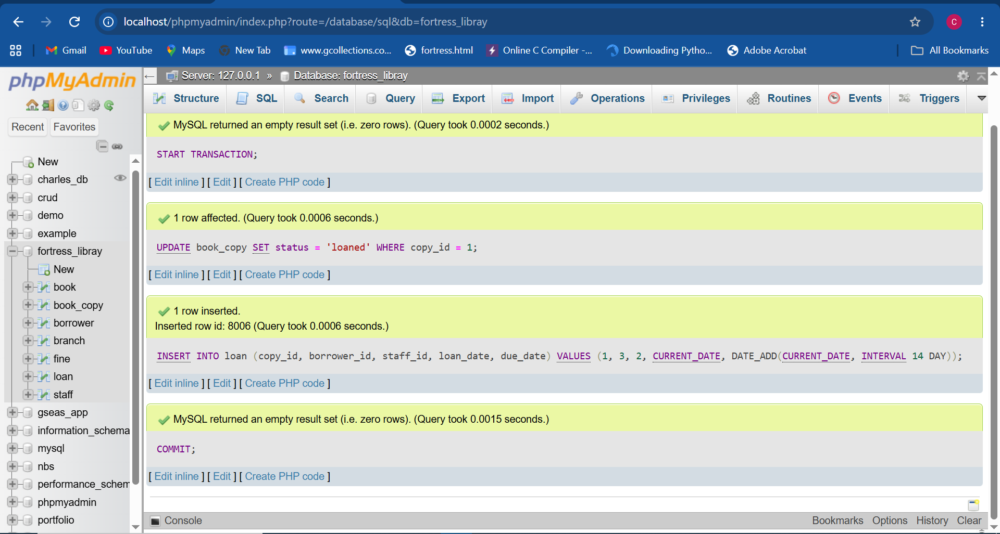
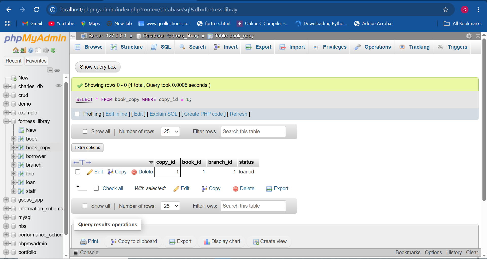

All three statements completed successfully, and a follow-up `SELECT`
confirmed `copy_id = 1` now shows `status: loaned` — the commit persisted.

## Demo 2 — ROLLBACK

```sql
START TRANSACTION;
SELECT status FROM book_copy WHERE copy_id = 1 LIMIT 1 FOR UPDATE;
ROLLBACK;
```

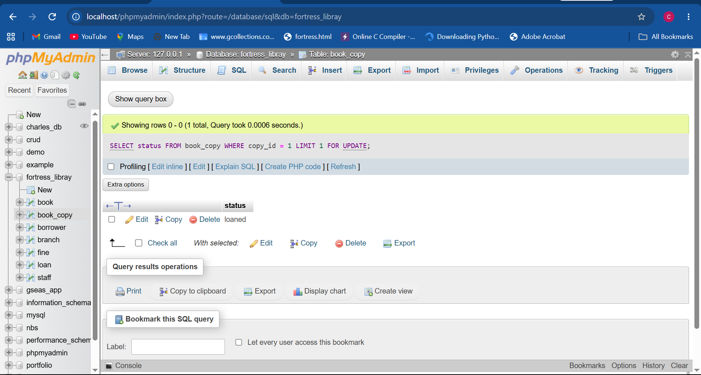
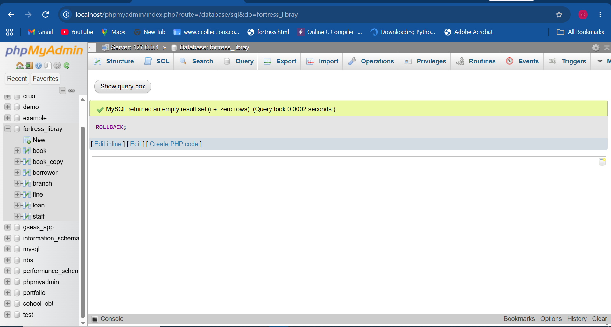

The transaction opened, read the row, and rolled back cleanly with no
changes written — confirmed by re-running the `SELECT` afterwards.

## Demo 3 — row-level locking (the centerpiece of this portfolio)

**Tab A** opens a transaction and locks a row:

```sql
START TRANSACTION;
SELECT * FROM fine WHERE fine_id = 1 LIMIT 1 FOR UPDATE;
```

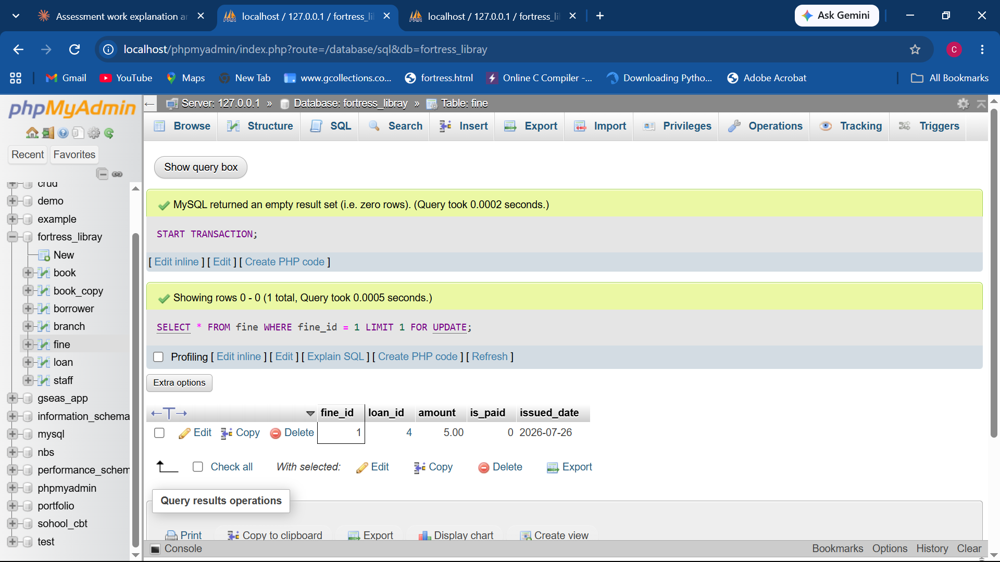

**Tab B**, immediately after, tries to lock the _same_ row:

```sql
START TRANSACTION;
SELECT * FROM fine WHERE fine_id = 1 LIMIT 1 FOR UPDATE;
```

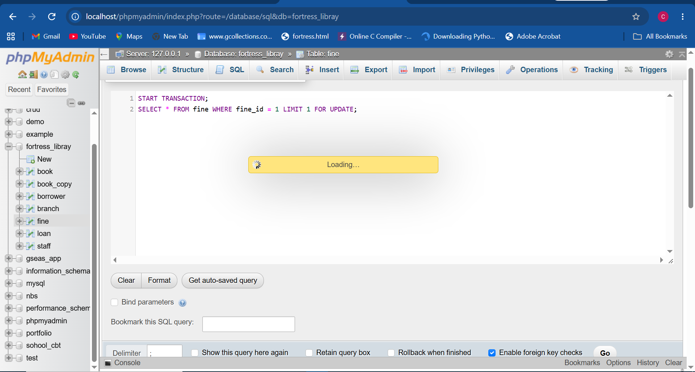

Tab B does not return — phpMyAdmin shows a loading spinner, proving
MariaDB is making Tab B's session wait for Tab A's lock to release. This
is the clearest possible evidence that row-level locking is real, not
just described in the SQL file.

**Tab A** releases the lock:

```sql
UPDATE fine SET is_paid = TRUE WHERE fine_id = 1;
COMMIT;
```

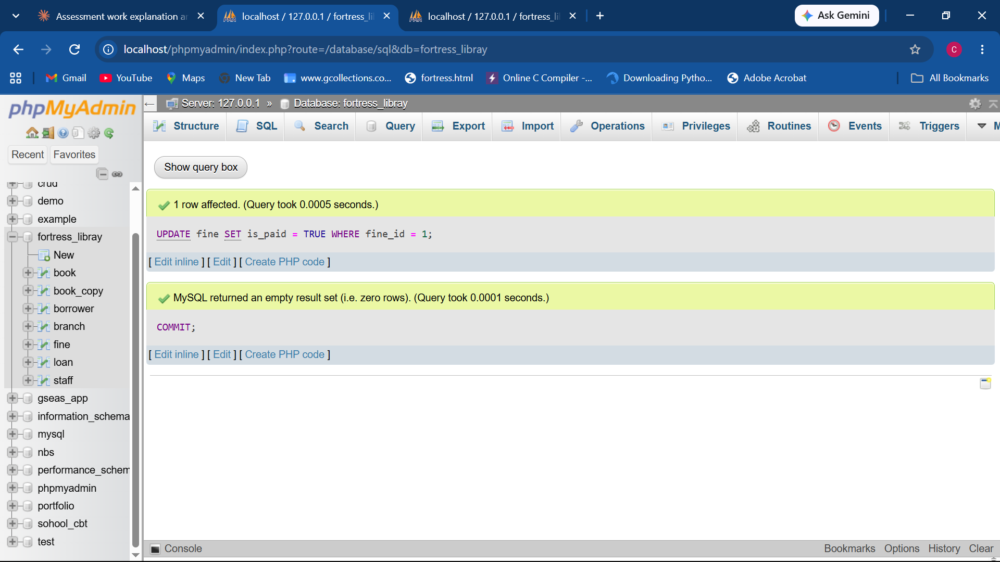

**Tab B** immediately unblocks the moment Tab A commits, and its `SELECT`
now returns the row with the _new_ committed value (`is_paid: 1`), proving
it was waiting on live data, not a cached/stale read:
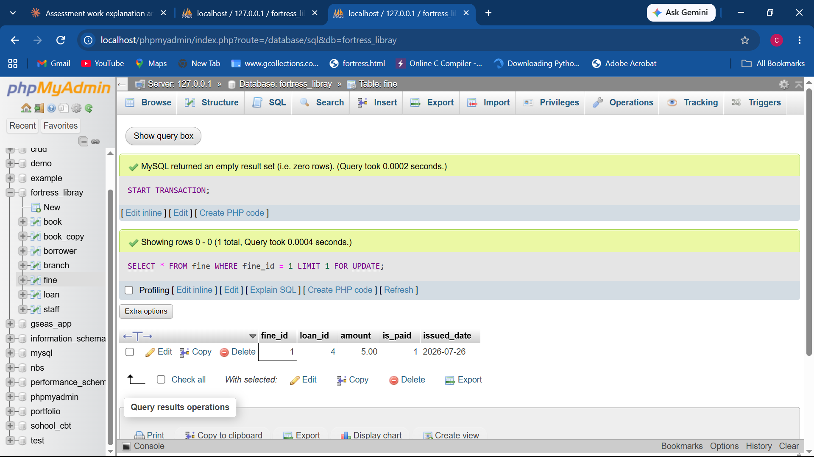

### What concurrency issue this addresses

The **lost update problem**: without locking, two concurrent transactions
can both read the same "before" state, both decide to write, and one
overwrite silently clobbers the other's change. In this library system
that matters most for `book_copy.status` (two staff accidentally lending
the same physical copy) and `fine.is_paid` (double-processing a payment).

### Control mechanism used

**Pessimistic locking** via `SELECT ... FOR UPDATE`, which takes a
row-level lock for the duration of the transaction, forcing concurrent
writers to wait rather than overwrite each other. The trade-off is
reduced concurrency/throughput under heavy contention, which an
**optimistic concurrency** approach (a `version` column checked on
UPDATE) could address instead, at the cost of needing retry logic in the
application.

## Demo 4 — isolation levels

### 4a. READ COMMITTED — non-repeatable read

**Tab A**, after setting the isolation level and opening a transaction:

```sql
SET SESSION TRANSACTION ISOLATION LEVEL READ COMMITTED;
START TRANSACTION;
SELECT status FROM book_copy WHERE copy_id = 2;
```

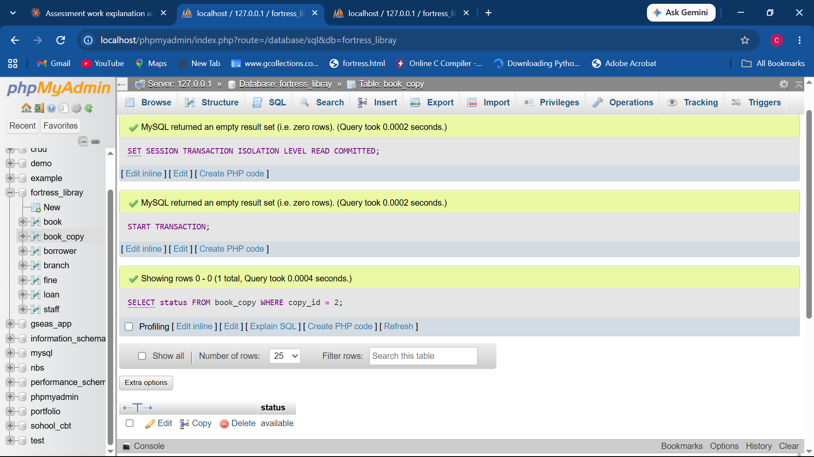
Result: `status: available`.

**Tab B** makes a real change and commits:

```sql
START TRANSACTION;
UPDATE book_copy SET status = 'loaned' WHERE copy_id = 2;
COMMIT;
```

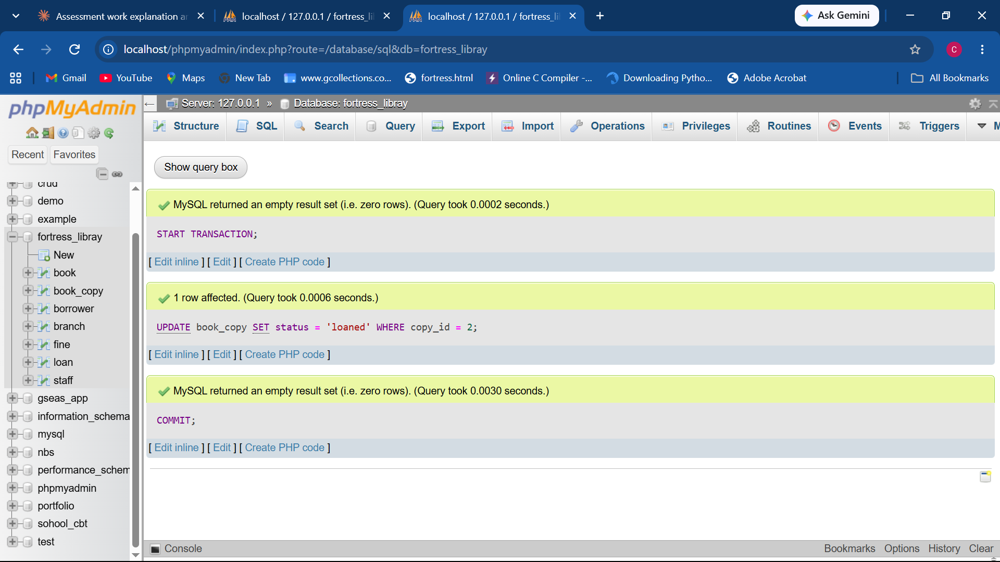
("1 row affected" confirms a genuine value change happened.)

**Tab A**, re-running the identical `SELECT` in the _same still-open_
transaction:

```sql
SELECT status FROM book_copy WHERE copy_id = 2;
```

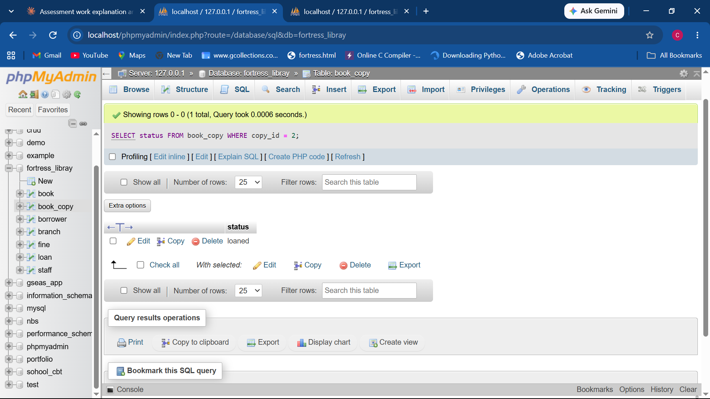
Result: `status: loaned` — the value changed mid-transaction, even though
Tab A's transaction never ended. This is a textbook **non-repeatable
read**, exactly what READ COMMITTED permits.

### 4b. SERIALIZABLE — an unexpected, honestly-reported result

Textbook SERIALIZABLE semantics say a plain `SELECT` inside a
SERIALIZABLE transaction should be treated as an implicit locking read,
blocking a conflicting `UPDATE` from another session until the first
transaction ends — the same way Demo 3's **explicit** `SELECT ... FOR
UPDATE` blocked successfully.

An initial attempt at this test gave a misleading result because of the
phpMyAdmin page-navigation issue noted above (switching to an individual
table's SQL tab silently ended the open transaction). After identifying
that cause and re-running the test correctly — **both tabs kept on the
same database-level SQL page throughout, with no navigation between
steps** — the result was reproduced consistently:

**Tab A:**

```sql
SET SESSION TRANSACTION ISOLATION LEVEL SERIALIZABLE;
START TRANSACTION;
SELECT status FROM book_copy WHERE copy_id = 2;
```

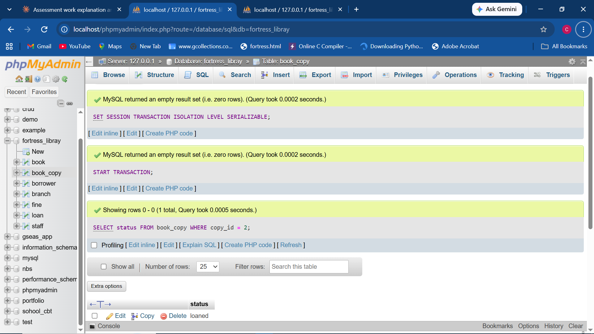
Result: `status: loaned`.

**Tab B:**

```sql
START TRANSACTION;
UPDATE book_copy SET status = 'available' WHERE copy_id = 2;
COMMIT;
```

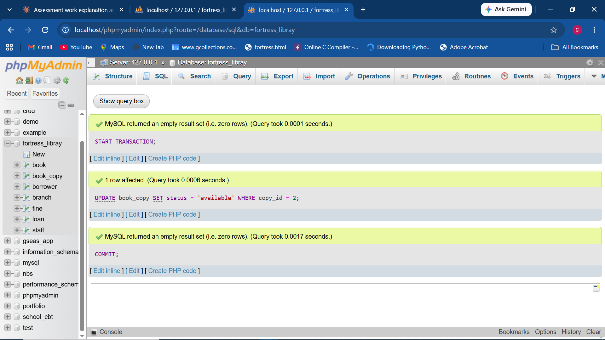
This completed in **0.0006 seconds** — no blocking at all, unlike the
explicit `FOR UPDATE` case in Demo 3.

**Tab A**, re-running the same `SELECT` in its still-open transaction:

```sql
SELECT status FROM book_copy WHERE copy_id = 2;
```

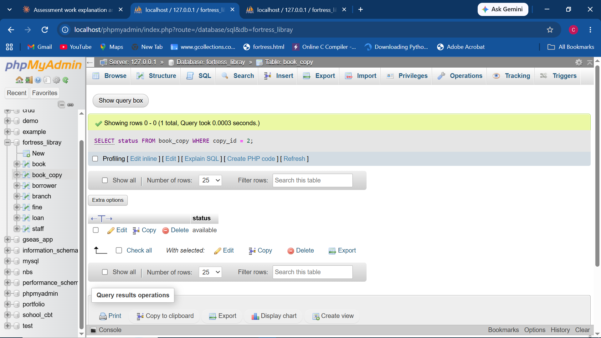
Result: `status: available` — Tab B's committed value, visible mid-
transaction in Tab A, which is itself a non-repeatable read.

**Finding:** in this specific MariaDB 10.4.28 setup, an **explicit**
`SELECT ... FOR UPDATE` reliably takes a row lock and blocks a concurrent
writer (Demo 3), but relying on the **SERIALIZABLE isolation level alone**
to implicitly lock a plain `SELECT` did not produce the expected blocking
behaviour in this test — the transaction still experienced a
non-repeatable read, the very thing SERIALIZABLE is meant to prevent.
This is reported as observed rather than assumed from documentation; a
plausible explanation is some interaction between phpMyAdmin's connection
handling and session-level isolation settings, but the explicit-locking
result in Demo 3 is the one to rely on for correctness in this
environment. Where strict isolation genuinely matters, explicit `FOR
UPDATE` locking is the dependable mechanism demonstrated here, not the
SERIALIZABLE isolation level on its own.
