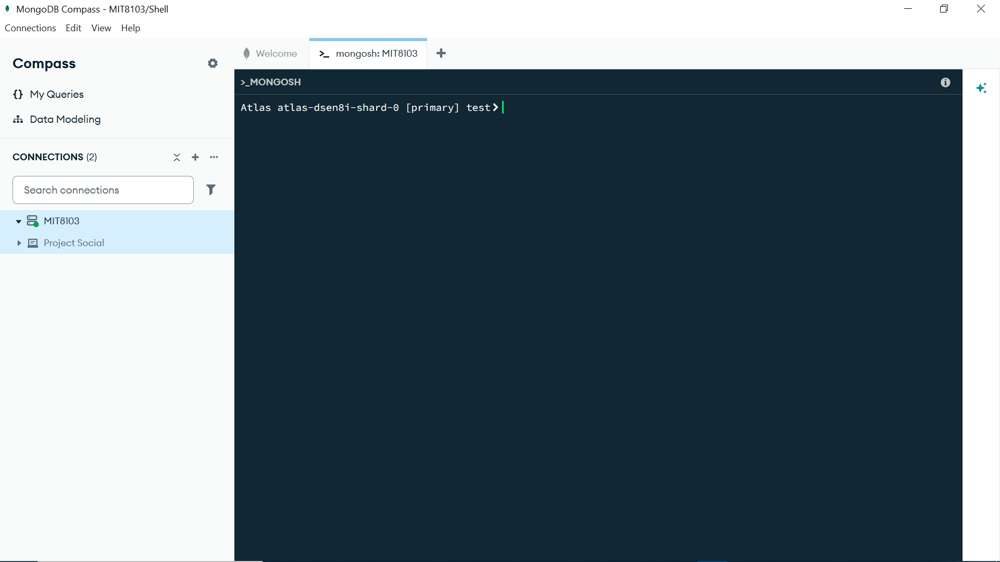
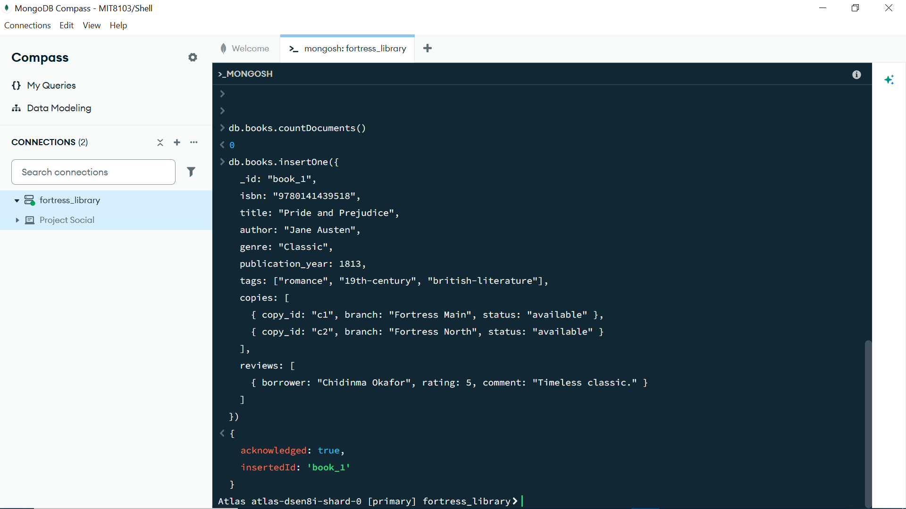
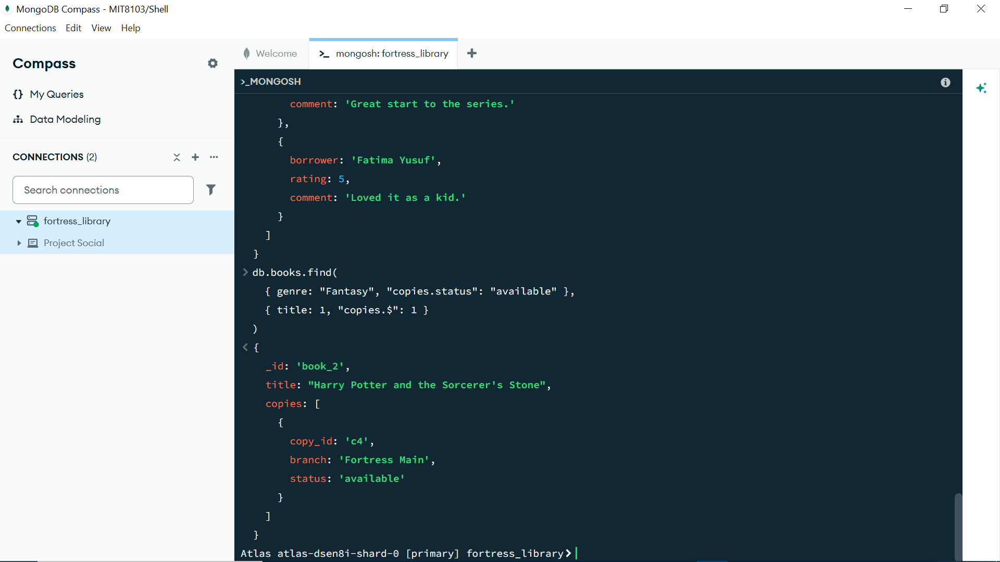
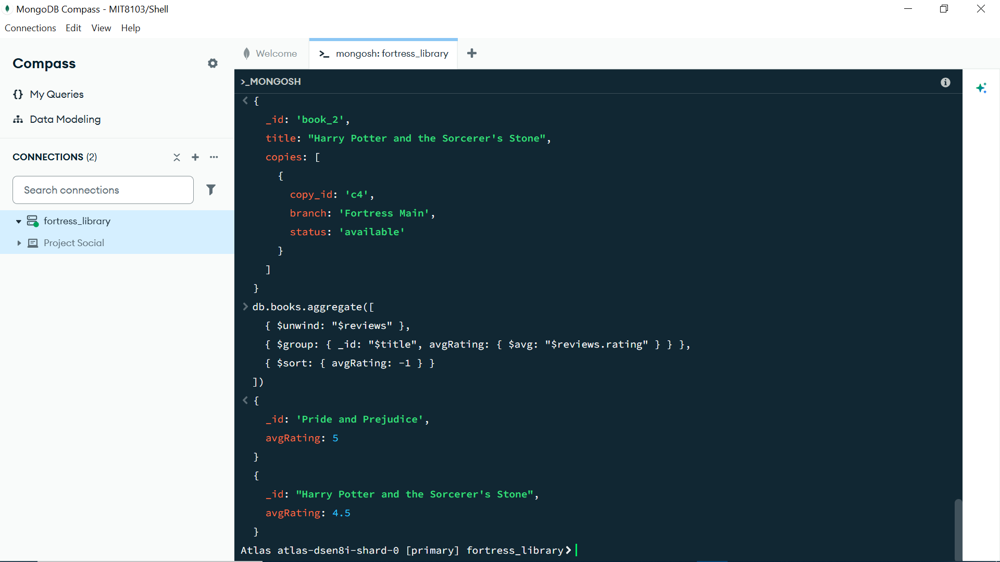
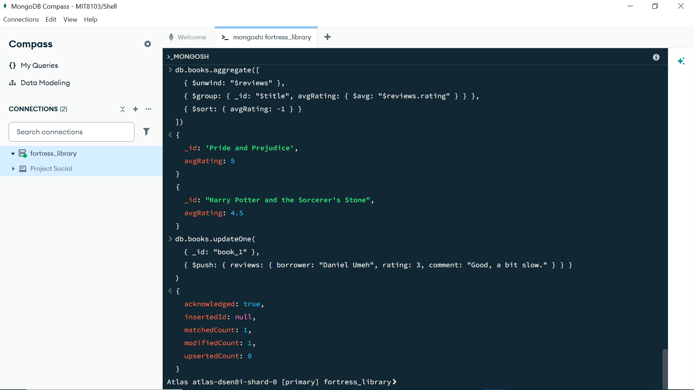
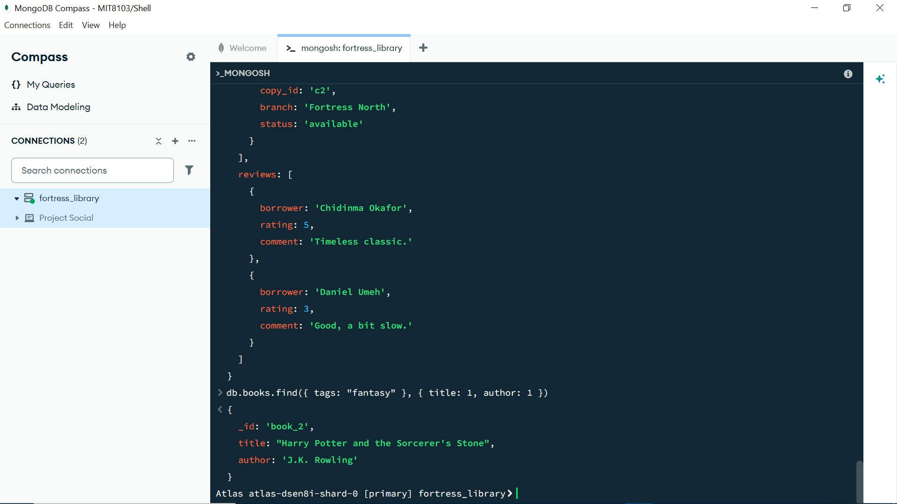

# Portfolio 4: NoSQL and Advanced Data Models

## Setup used

MongoDB Atlas, free M0 tier, deployed as a genuine 3-node replica set
(`atlas-dsen8i-shard-0`) in AWS Paris (eu-west-3), connected to via
MongoDB Compass's embedded MongoSH shell.




## Model chosen: Document store (MongoDB)

### Why document, not key-value/column/graph

- **Key-value** fits simple lookups (e.g., session caching) but can't
  naturally express a book's nested metadata or embedded reviews.
- **Column store** (e.g., Cassandra) shines for massive write-heavy,
  time-series data (like IoT sensor logs) — overkill for a library
  catalogue.
- **Graph** (e.g., Neo4j) would fit a *recommendation engine* ("borrowers
  who read X also read Y") well, but that's not the library's core daily
  operation.
- **Document** fits best because the library catalogue is naturally
  **semi-structured and hierarchical**: a book has a variable number of
  reviews, tags, and copies that don't fit neatly into fixed relational
  columns, and the application mostly reads/writes "one full book record"
  at a time — a natural match for a single JSON document.

## Implementation: catalogue as documents

### Inserting the catalogue

`insertMany()` with both books pasted as a single multi-line block
returned `countDocuments() == 0` afterwards despite appearing to echo
back successfully — the insert silently did not take effect, likely due
to how the MongoSH shell in Compass handled the large pasted array.
Switching to two separate `insertOne()` calls resolved this immediately
and reliably:

```javascript
db.books.insertOne({
  _id: "book_1",
  isbn: "9780141439518",
  title: "Pride and Prejudice",
  author: "Jane Austen",
  genre: "Classic",
  publication_year: 1813,
  tags: ["romance", "19th-century", "british-literature"],
  copies: [
    { copy_id: "c1", branch: "Fortress Main", status: "available" },
    { copy_id: "c2", branch: "Fortress North", status: "available" }
  ],
  reviews: [
    { borrower: "Chidinma Okafor", rating: 5, comment: "Timeless classic." }
  ]
})
```


```javascript
db.books.insertOne({
  _id: "book_2",
  isbn: "9780439708180",
  title: "Harry Potter and the Sorcerer's Stone",
  author: "J.K. Rowling",
  genre: "Fantasy",
  publication_year: 1997,
  tags: ["fantasy", "young-adult", "magic"],
  copies: [
    { copy_id: "c3", branch: "Fortress Main", status: "loaned" },
    { copy_id: "c4", branch: "Fortress Main", status: "available" }
  ],
  reviews: [
    { borrower: "James Carter", rating: 4, comment: "Great start to the series." },
    { borrower: "Fatima Yusuf", rating: 5, comment: "Loved it as a kid." }
  ]
})
```


Both returned a clean `{ acknowledged: true, insertedId: '...' }`, and
`db.books.countDocuments()` confirmed `2` immediately after.

### Verifying the data

```javascript
db.books.find().pretty()
```


### Query 1 — available copies of fantasy books

```javascript
db.books.find(
  { genre: "Fantasy", "copies.status": "available" },
  { title: 1, "copies.$": 1 }
)
```


The `copies.$` positional operator correctly returned only the one
matching copy (`c4`, available) out of `book_2`'s two copies, excluding
`c3` (loaned) — proving the positional projection works as intended
against an embedded array.

### Query 2 — average rating per book (aggregation pipeline)

```javascript
db.books.aggregate([
  { $unwind: "$reviews" },
  { $group: { _id: "$title", avgRating: { $avg: "$reviews.rating" } } },
  { $sort: { avgRating: -1 } }
])
```


Result: Pride and Prejudice averaged **5** (its one review), Harry Potter
averaged **4.5** (mean of 4 and 5), sorted descending as requested.

### Query 3 — add a new review (embedded document push)

```javascript
db.books.updateOne(
  { _id: "book_1" },
  { $push: { reviews: { borrower: "Daniel Umeh", rating: 3, comment: "Good, a bit slow." } } }
)
```


`matchedCount: 1, modifiedCount: 1, upsertedCount: 0` confirmed a genuine
update to the existing document rather than an accidental insert.
Verified with:
```javascript
db.books.findOne({_id: "book_1"})
```


The `reviews` array now correctly holds both the original review and the
newly pushed one.

### Query 4 — tag-based search

```javascript
db.books.find({ tags: "fantasy" }, { title: 1, author: 1 })
```


Correctly returned only `book_2` (the sole title tagged `"fantasy"`),
with just the requested fields projected.

## Why this suits the catalogue specifically (vs. the relational model)

- **Reviews and tags are variable-length** — some books have zero
  reviews, others several. In SQL this needs a separate `review` table
  and a JOIN for every read; in MongoDB it's naturally embedded, and a
  single `find()` returns the full book record including all reviews in
  one round-trip — good for the catalogue page, which is read far more
  often than it's written.
- **Schema flexibility**: adding a new attribute to some books (e.g., an
  `audiobook_url` field only for titles that have one) requires no schema
  migration in MongoDB, whereas the relational model would need an
  `ALTER TABLE` or a nullable column used by only a few rows.
- **Trade-off**: this denormalised model duplicates review author names
  inside each book document rather than referencing a normalised
  `borrower` table, which is fine for read-heavy catalogue browsing but
  would make "find all reviews by borrower X" slower across the whole
  catalogue — the classic SQL-normalisation vs. NoSQL-denormalisation
  trade-off, directly observable by comparing this model against
  Portfolio 1's relational schema for the same case study.

## Troubleshooting note worth keeping in the reflection

The initial `insertMany()` attempt appeared in the shell's scrollback as
if it had succeeded, but `countDocuments()` returned `0` — a reminder not
to trust an operation "looked like it ran" without a follow-up read to
confirm state actually changed. Splitting into two `insertOne()` calls
isolated and resolved the issue immediately.
